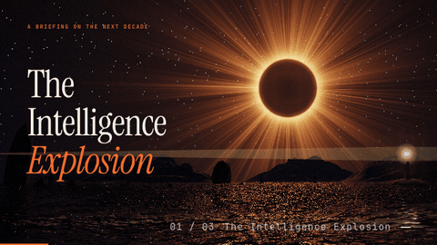
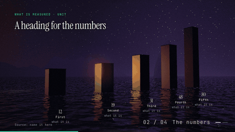
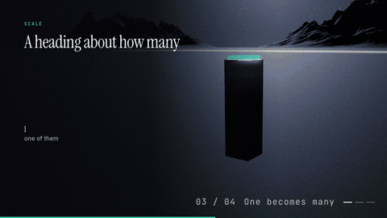
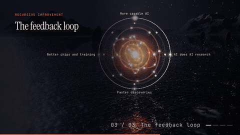
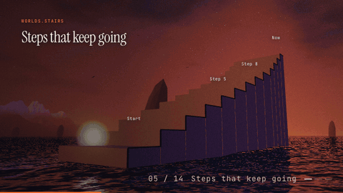
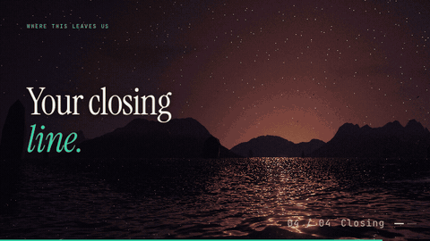
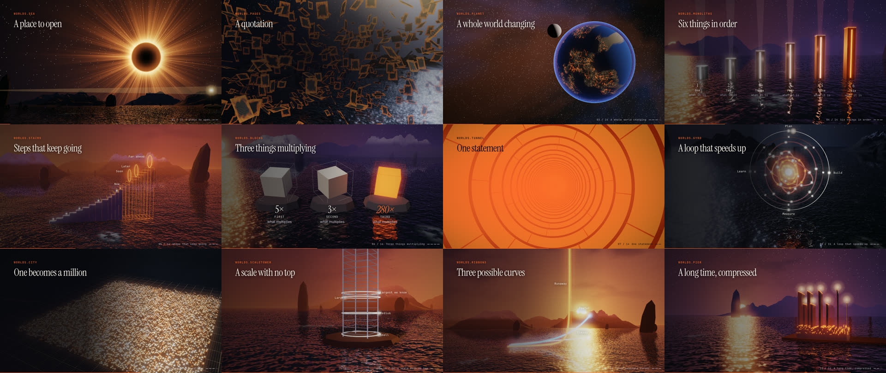
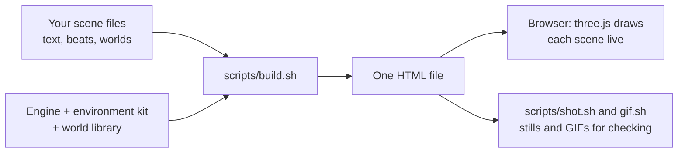

# Scenecraft

Turns any topic into a cinematic 3D talk: every slide is a live world with a flying camera, an animated ocean and sky, click-through steps and speaker notes, all in one HTML file.



Scenecraft is a skill for [Claude Code](https://claude.com/claude-code). It gives Claude a tested 3D engine, an environment kit and a library of ready-made worlds, so its effort goes into your story instead of the plumbing. You can also use it by hand.

## What it can do

| | |
|---|---|
|  |  |
| **Numbers become places.** Edit a list of values and the towers follow. Their light strips reflect in the water. | **Scale you can feel.** One becomes a hundred, then ten thousand, as the camera rises. |
|  |  |
| **Mechanisms that move.** Each click changes the world, not only the text. | **Camera moves per click.** The camera flies to a new position on every step. |



**A sky that changes.** Six skies (eclipse, night, pre-dawn, blue hour, dusk, dawn) and blending between them, so a talk can open at night and close at sunrise.

Built in:

- An ocean with waves, sun glitter and true reflections of everything standing in it
- Islands, sea stacks, a lighthouse, birds, clouds, stars and a moon
- Bloom, tone mapping, film grain and five scene transitions
- Text and labels pinned to 3D points, which follow the camera
- Speaker notes, an overview, full screen, keyboard and swipe controls
- Phone layout, reduced-motion support, and automatic resolution scaling on slow GPUs

## Thirteen ready-made worlds



`sea` · `pages` · `planet` · `monoliths` · `stairs` · `blocks` · `tunnel` · `gyro` · `city` · `scaleTower` · `ribbons` · `pier` · `hangingSun`

Each is one line to use, and you can add your own. See [references/worlds.md](references/worlds.md).

## Setup

**1. Install the skill**

```sh
git clone https://github.com/vishc1/Scenecraft ~/.claude/skills/scenecraft
```

**2. Ask Claude Code for a talk**

> Make me a cinematic 3D talk about how coral reefs die and recover, about ten scenes.

Claude writes the story as click-through steps, picks or builds a world for each scene, renders stills to check its own work, and hands you one HTML file.

**3. Present it**

Open the file in a browser. Right arrow or click advances, left arrow goes back, `N` shows speaker notes, `O` the overview, `F` full screen, `?` the key list.

### Try it without Claude

```sh
cd ~/.claude/skills/scenecraft
scripts/build.sh out/gallery.html "World gallery" assets/examples/gallery.js
open out/gallery.local.html          # every library world, one after another
```

## How it works



A talk is a list of scenes. A scene has two halves:

- **Text:** a title, up to four *beats* (one click each) with speaker notes, text blocks, and labels.
- **A world:** camera positions (one per beat) and a `build` function that creates the 3D objects and says how they change as each beat plays.

```js
SC.push({...WORLDS.gyro({labels:['Plan','Build','Measure','Learn']}),   // the world, from the library
  id:'cycle', title:'The cycle', kind:4,                                // the text
  beats:[{dur:2.4,note:'Draw the loop.'},{dur:2,note:'Each turn is faster.'}],
  layers:[{b:[0,1],z:'tl',h:'<p class="eb">How we work</p><h2>The cycle</h2>'}]});
```

On every frame the engine eases the camera toward the current beat's position, runs the world's update, renders the scene (twice when there is water, once from a mirrored camera for the reflections), then applies bloom, tone mapping and the transition.

## Making your own scenes

There are three levels, and a talk usually mixes them:

1. **Use a library world** and pass your own labels, as above.
2. **Adapt one:** copy its function out of `assets/library/worlds.js` into your scene file and change the geometry. Each is ten to thirty lines.
3. **Build a new world:** write `cams` and `build` yourself with the helpers in [references/scene-api.md](references/scene-api.md) (instancing, glow, sky, ocean, islands). `assets/examples/starter-any-topic.js` is a working four-scene talk to start from.

To share a world you built, give it the library shape (`WORLDS.name = (options) => ...`) as described in [references/worlds.md](references/worlds.md), and send a pull request.

## What is inside

| Path | What it is |
|---|---|
| `SKILL.md` | The instructions Claude follows: story first, one visual idea per scene, build, look at every scene, publish |
| `assets/engine/` | The engine and the environment kit (ocean, skies, islands, birds) |
| `assets/library/worlds.js` | The thirteen ready-made worlds |
| `assets/examples/` | `starter-any-topic.js` (a blank four-scene talk), `gallery.js` (every world), `example-scenes.js` (three finished scenes) |
| `scripts/build.sh` | Assembles one HTML file from the engine and your scene files |
| `scripts/shot.sh`, `sheet.sh`, `gif.sh` | Render a still of any scene, tile four stills, or render a scene in motion as a GIF |
| `references/` | The scene format, the world library, the environment options, and lessons learned |

## Requirements

- A browser with WebGL2. The page loads three.js r128 from cdnjs and three typefaces from Google Fonts, so it needs a network connection.
- For the scripts: `python3`; a Chromium build for `shot.sh` and `gif.sh` (Playwright's cache, Google Chrome, or `CHROMIUM_PATH`); `ffmpeg` for `sheet.sh` and `gif.sh`.

## Notes

- The images above were rendered by the scripts in this repository on a software renderer. Frame rate in a real browser depends on your GPU; water scenes draw the world twice.
- The figures in `example-scenes.js` were written from memory for a demonstration talk. Check them before reusing.

## Credits

The engine, shaders, worlds and scripts in this repository were written for this project. It builds on:

- [three.js](https://threejs.org) (MIT), loaded from a CDN and not bundled
- Instrument Serif, Inter and JetBrains Mono (SIL Open Font License), loaded from Google Fonts
- The ACES filmic tone-mapping curve fit published by Krzysztof Narkowicz
- Standard graphics techniques: value noise, Gerstner waves, Schlick's Fresnel approximation and planar reflections

## License

MIT. See [LICENSE](LICENSE).
